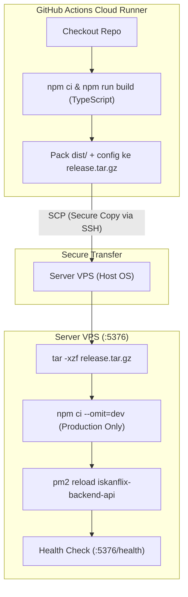

# Panduan CI/CD: Build di Runner, Kompresi & Deploy Artifact ke VPS (PM2)

Strategi ini adalah **best practice industri**:
1. **CPU & RAM VPS 100% Hemat**: Proses kompilasi TypeScript (`tsc`) dan download dependensi pengembangan dilakukan sepenuhnya di cloud GitHub Actions Runner.
2. **VPS Sangat Bersih**: VPS Anda **tidak perlu meng-clone git repo** dan tidak butuh `devDependencies` (seperti TypeScript, ts-node, @types).
3. **Ukuran Transfer Kecil**: Hanya file hasil build (`dist/`), file konfigurasi PM2, dan `package.json` yang dikompresi ke file `.tar.gz` dan dikirim via SCP.

---

## 1. Arsitektur CI/CD Artifact Shipping



---

## 2. Persiapan di Server VPS (Cukup Sekali)

Masuk ke VPS via SSH:
```bash
ssh user@IP_VPS_ANDA
```

### Langkah 2.1: Pasang Node.js 22 LTS & PM2
```bash
# 1. Update repo sistem & dependensi dasar
sudo apt update && sudo apt install -y curl ca-certificates tar

# 2. Pasang Node.js 22 LTS
curl -fsSL https://deb.nodesource.com/setup_22.x | sudo -E bash -
sudo apt install -y nodejs

# 3. Pasang PM2 secara global
sudo npm install -g pm2
```

### Langkah 2.2: Pasang Library Visual untuk Chromium di VPS
Agar headless Chromium Puppeteer berjalan mulus di OS host:
```bash
sudo apt install -y \
  libasound2 \
  libatk-bridge2.0-0 \
  libatk1.0-0 \
  libcairo2 \
  libcups2 \
  libdbus-1-3 \
  libdrm2 \
  libgbm1 \
  libglib2.0-0 \
  libgtk-3-0 \
  libnspr4 \
  libnss3 \
  libpango-1.0-0 \
  libx11-6 \
  libxcb1 \
  libxcomposite1 \
  libxdamage1 \
  libxext6 \
  libxfixes3 \
  libxrandr2 \
  libxss1 \
  fonts-liberation
```

### Langkah 2.3: Siapkan Folder Deployment di VPS
Cukup buat satu folder kosong untuk meletakkan rilis backend:
```bash
mkdir -p ~/iskanflix-backend
```
*(Tidak perlu `git clone` di folder ini, karena GitHub Actions yang akan mengirim rilis siap pakai ke folder ini).*

### Langkah 2.4: Buka Port 5376 di Firewall
```bash
sudo ufw allow 5376/tcp
sudo ufw reload
```

### Langkah 2.5: Buat SSH Key untuk GitHub Actions
Di VPS, jalankan:
```bash
ssh-keygen -t ed25519 -C "github-actions-deploy" -f ~/.ssh/github_actions_key -N ""

cat ~/.ssh/github_actions_key.pub >> ~/.ssh/authorized_keys
chmod 600 ~/.ssh/authorized_keys
```

Tampilkan isi private key untuk disalin ke GitHub Secrets:
```bash
cat ~/.ssh/github_actions_key
```

---

## 3. Pengaturan GitHub Repository Secrets

Buka repositori GitHub Anda di browser:
1. Masuk ke **Settings** > **Secrets and variables** > **Actions**.
2. Klik **New repository secret**, lalu masukkan:

| Nama Secret | Nilai / Value | Contoh |
| :--- | :--- | :--- |
| `VPS_HOST` | IP publik VPS Anda | `103.123.45.67` |
| `VPS_USER` | Username SSH VPS Anda | `ubuntu` atau `root` |
| `VPS_PASSWORD` | Password user VPS Anda | `password_vps_anda` |
| `VPS_PORT` | Port SSH | `22` |
| `VPS_TARGET_DIR` | Path folder di VPS yang dibuat di langkah 2.3 | `/home/ubuntu/iskanflix-backend` |

---

## 4. Alur Kerja Otomasi di GitHub Actions

File workflow berada di: [`.github/workflows/deploy-backend.yml`](file:///.github/workflows/deploy-backend.yml)

Saat Anda melakukan `git push origin main`:
1. **GitHub Runner**:
   - Menjalankan `npm ci` dan `npm run build` (mengompilasi TypeScript menjadi JavaScript siap pakai di folder `dist/`).
   - Mengemas `dist/`, `package.json`, dan `ecosystem.config.cjs` menjadi file arsip `release.tar.gz`.
2. **Transfer SCP**:
   - Mengunggah `release.tar.gz` langsung ke folder `VPS_TARGET_DIR` di VPS via SCP terenkripsi.
3. **Eksekusi di VPS**:
   - Mengekstrak `release.tar.gz`.
   - Menjalankan `npm ci --omit=dev` (hanya menginstall modul runtime produksi, super cepat).
   - Memastikan browser Puppeteer siap.
   - Mereload service dengan PM2 tanpa downtime: `pm2 reload ecosystem.config.cjs`.
   - Memverifikasi respon `http://localhost:5376/health`.

---

## 5. Perintah Monitoring di VPS

Kapan pun Anda ingin memantau backend di VPS:
- **Cek Status**: `pm2 list`
- **Lihat Log Real-time**: `pm2 logs iskanflix-backend-api`
- **Monitor RAM & CPU**: `pm2 monit`
- **Restart Manual**: `pm2 restart iskanflix-backend-api`

---

## 6. Setup Domain & HTTPS dengan Caddy (Opsional)

Jika ingin memakai domain dan SSL gratis:
1. Pasang Caddy di VPS:
   ```bash
   sudo apt install -y debian-keyring debian-archive-keyring apt-transport-https curl
   curl -1sLf 'https://dl.cloudsmith.io/public/caddy/stable/gpg.key' | sudo gpg --dearmor -o /usr/share/keyrings/caddy-stable-archive-keyring.gpg
   curl -1sLf 'https://dl.cloudsmith.io/public/caddy/stable/debian.deb.txt' | sudo tee /etc/apt/sources.list.d/caddy-stable.list
   sudo apt update && sudo apt install caddy
   ```
2. Isi `/etc/caddy/Caddyfile`:
   ```caddy
   api.domainanda.com {
       reverse_proxy localhost:5376
   }
   ```
3. Restart Caddy: `sudo systemctl restart caddy`.
